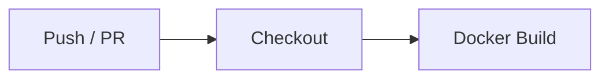

<div align="center">

# 📚 Library API

**API RESTful moderna construída com Spring Boot, PostgreSQL, Docker e CI/CD automatizado.**

[](https://openjdk.org/)
[](https://spring.io/projects/spring-boot)
[](https://www.postgresql.org/)
[](https://www.docker.com/)
[](https://github.com/features/actions)

<p align="center">
  <a href="#-principais-recursos">Recursos</a> •
  <a href="#-requisitos">Requisitos</a> •
  <a href="#-inicialização-rápida-com-docker">Docker</a> •
  <a href="#-variáveis-de-ambiente-envs">Variáveis de Ambiente</a> •
  <a href="#-execução-local-desenvolvimento">Execução Local</a> •
  <a href="#-esteira-de-cicd-github-actions">CI/CD</a> •
  <a href="#-estrutura-do-projeto">Estrutura</a>
</p>

</div>

---

## 🌟 Principais Recursos

- 🚀 **Arquitetura Moderna**: Spring Boot com JPA/Hibernate e HikariCP para alta performance em pool de conexões.
- 🐘 **Banco de Dados PostgreSQL**: Totalmente integrado com suporte a migração automática via Hibernate e suporte a profiles.
- 🐳 **Docker Multi-Stage Build**: Imagem final enxuta baseada em Alpine Linux (`eclipse-temurin:17-jre-alpine`), garantindo tamanho reduzido e inicialização ultrarrápida.
- 🔒 **Segurança em Contêineres**: A aplicação é executada como usuário sem privilégios (`non-root user`) dentro do contêiner.
- 🩺 **Healthcheck Nativo**: Integração com Spring Boot Actuator (`/actuator/health`) acoplado ao `docker-compose` e Kubernetes readiness/liveness.
- ⚙️ **Configuração Elegante via `.env`**: Totalmente orientada a 12-Factor App, separando configurações de ambiente e credenciais do código.
- 🧪 **Testes Automatizados com H2**: Bateria de testes que roda sem depender de banco externo ligado para testes unitários, além de integração com PostgreSQL no CI.
- 🤖 **CI/CD Automatizado**: Pipeline no GitHub Actions que valida compilação, testes unitários, build da imagem Docker e integridade da stack.

---

## 📋 Requisitos

Para executar a aplicação com contêineres:
- [Docker Engine](https://docs.docker.com/engine/install/) `>= 24.0`
- [Docker Compose](https://docs.docker.com/compose/) `>= 2.20`

Para desenvolvimento local direto na máquina:
- [Java JDK 17](https://adoptium.net/) ou superior
- [Maven 3.8+](https://maven.apache.org/) (ou utilize o `./mvnw` incluso)

---

## 🚀 Inicialização Rápida com Docker

A forma mais simples e recomendada para rodar toda a aplicação e o banco de dados PostgreSQL é via Docker Compose.

### 1. Clonar e Acessar o Diretório

```bash
cd libraryapi
```

### 2. Configurar o Arquivo `.env`

O projeto já contém um arquivo `.env.example` documentado. Crie seu `.env` a partir dele:

```bash
cp .env.example .env
```

> **Dica:** Os valores padrão já vêm configurados para rodar perfeitamente no Docker!

### 3. Subir os Contêineres

Execute o comando abaixo para construir a imagem da API e inicializar o PostgreSQL:

```bash
docker compose up -d --build
```

O Docker Compose cuidará de:
1. Subir o contêiner do **PostgreSQL 16**.
2. Aguardar o banco ficar **100% saudável** (`condition: service_healthy`).
3. Construir e iniciar a **Library API** conectando-se ao banco.

### 4. Verificar o Status e Logs

Para acompanhar os logs em tempo real:
```bash
docker compose logs -f app
```

Para verificar o status de saúde dos contêineres:
```bash
docker compose ps
```

### 5. Testar a Aplicação

Acesse no navegador ou via terminal:

- **Healthcheck**: [http://localhost:8080/actuator/health](http://localhost:8080/actuator/health)
- **Info da Aplicação**: [http://localhost:8080/actuator/info](http://localhost:8080/actuator/info)

### 6. Parar a Aplicação

```bash
# Para os contêineres mantendo os dados do banco
docker compose down

# Para e remove também os volumes de dados
docker compose down -v
```

---

## ⚙️ Variáveis de Ambiente (Envs)

As variáveis de ambiente são centralizadas nos arquivos `.env` e mapeadas no `src/main/resources/application.yml`.

| Variável | Padrão | Descrição |
| :--- | :--- | :--- |
| `SERVER_PORT` | `8080` | Porta HTTP da aplicação |
| `SPRING_PROFILES_ACTIVE` | `prod` | Perfil ativo do Spring Boot |
| `DB_HOST` | `postgres` | Host do banco (use `localhost` para dev local sem Docker) |
| `DB_PORT` | `5433` | Porta externa do PostgreSQL (5433 para evitar conflito com Postgres local) |
| `DB_NAME` | `librarydb` | Nome do banco de dados |
| `DB_USER` | `postgres` | Usuário do banco de dados |
| `DB_PASSWORD` | `postgres123` | Senha do usuário do banco |
| `DB_POOL_MAX_SIZE` | `10` | Quantidade máxima de conexões no HikariCP |
| `DB_POOL_MIN_IDLE` | `2` | Mínimo de conexões ociosas no pool |
| `JPA_DDL_AUTO` | `update` | Estratégia do Hibernate (`none`, `validate`, `update`, `create-drop`) |
| `JPA_SHOW_SQL` | `true` | Exibe as queries SQL executadas no console |
| `JPA_FORMAT_SQL` | `true` | Formata as queries SQL para fácil leitura |
| `JAVA_OPTS` | `-XX:+UseContainerSupport...` | Flags de controle de memória da JVM no contêiner |

---

## 💻 Execução Local (Desenvolvimento)

Caso queira rodar o Java diretamente na sua máquina e apenas o PostgreSQL no Docker:

### 1. Iniciar apenas o banco PostgreSQL:
```bash
docker compose up -d postgres
```

### 2. Ajustar o `.env` ou rodar a aplicação com `DB_HOST=localhost`:
```bash
# Linux/macOS
export DB_HOST=localhost
./mvnw spring-boot:run

# Windows (PowerShell)
$env:DB_HOST="localhost"
.\mvnw.cmd spring-boot:run
```

### 3. Rodar os Testes Automatizados:
```bash
# Linux/macOS
./mvnw clean test

# Windows (PowerShell)
.\mvnw.cmd clean test
```

---

## 🔄 Esteira de CI/CD (GitHub Actions)

O projeto conta com um fluxo de CI simples, direto e rápido configurado em `.github/workflows/ci.yml`.



### O que o CI faz:
1. **Checkout do código**: Baixa o repositório na máquina virtual do GitHub Actions.
2. **Build da imagem Docker**: Executa `docker build .`, que compila o projeto dentro do estágio builder do Dockerfile e valida a geração da imagem final.

---


## 🛠️ Comandos Docker Úteis

```bash
# Visualizar logs da aplicação em tempo real
docker compose logs -f app

# Visualizar logs do PostgreSQL
docker compose logs -f postgres

# Entrar no bash do contêiner da aplicação
docker compose exec app sh

# Entrar no cliente psql do banco
docker compose exec postgres psql -U postgres -d librarydb

# Reconstruir imagens após alteração de código
docker compose up -d --build
```

---

<div align="center">
  <sub>Desenvolvido com carinho para o ecossistema <strong>Library API</strong>.</sub>
</div>
